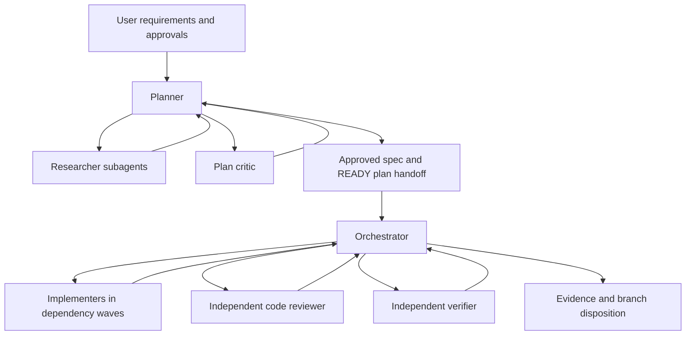

# Deep audit: Antigravity Coding Team in AGY

**Audit date:** 22 October 2026, Asia/Calcutta. **Mode:** research only.

**Architecture boundary:** the coding team consists of the **planner, orchestrator, and their researcher, plan-critic, implementer, code-reviewer, and verifier subagents**. Skills, rules, and MCP tools support those roles. **AntigravityMasterSupervisor is an incomplete, ongoing target project built using this architecture. It is not part of the coding team's orchestration architecture.** AntigravityUsageDashboard is another target project. Project defects are used as evidence about development behavior only when plans, traces, and source support that connection.

## 1. Executive summary

The coding team has a sound basic division of responsibilities. Research, specification approval, plan criticism, implementation, independent code review, and verification all provide observable value. Critics found concrete omissions; reviewers caught integration defects; corrective iterations produced real passing checks. One sampled execution correctly waited for fixes, committed, independently verified, and obtained merge approval.

The most important weaknesses concern **preserving requirements and evidence across those roles**, rather than the number of roles. The investigation supports five conclusions:

1. **Specification and plan consistency is stronger than original-requirement coverage.** In the Supervisor redesign, explicit source requirements for region dividers and viewport containment were dropped during translation into the implementation specification and plan. In the Dashboard, planned acceptance checks do not fully exercise interaction and chart-lifecycle requirements. These are development-process signals from two target projects, not a claim that incomplete Supervisor features invalidate the architecture.
2. **A historical orchestrator crossed the outstanding-writer barrier.** Its independent verifier finished before review fixes were edited. The orchestrator later ran real passing checks on the corrected code, but final independent verification was absent. Current instructions address this ordering problem; the historical trace does not establish a current regression. A second run followed the correct sequence.
3. **Completion reporting can overstate intermediate evidence.** The same run claimed a fix commit before it existed, and a command sequence ended successfully despite an earlier failed commit. Separately, several prior-audit repair attributions do not match current source or cited Git changes. These support tighter evidence reporting; the cause of the old report's inaccuracies is unknown.
4. **Current AGY instruction layers have avoidable drift.** Agent roles and loaded skills disagree about worker commits, parallelism, and review cadence. Specific role instructions can resolve these conflicts, and historical dispatches demonstrate that resolution. This is a maintenance and consistency issue, not proof that the architecture is unusable.
5. **The graph integration has a small, concrete API mismatch.** Rules prescribe two argument values rejected by the inspected installed implementation. Other concerns—repository context, asynchronous freshness, and read-only role capabilities—are limitations to manage, not demonstrated contamination or misuse.

The highest-value improvements are to make original-requirement coverage explicit before READY; validate the existing async and final-verification rules against a delayed-fixer scenario; align AGY skills with agent-role policy; and preserve exact approval and completion identities in existing handoffs. These changes fit the current architecture. **No additional agent, skill layer, scheduler, MCP server, or Supervisor dependency is justified by this evidence.**

Supervisor-specific issues such as plan-file discovery and CLI passthrough are secondary project observations. They do not lead the architecture assessment or roadmap. Current project incompleteness is not treated as workflow failure.

## 2. Investigation scope and methodology

### Sources and examined state

| Source | Examined state | Use in this audit |
|---|---|---|
| Plugin source | `D:/Code/antigravity-coding-team`, HEAD `883c3290962e471bcd87ca79e0522887934968fd`, clean | AGY agents, skills, rules, templates, MCP configuration; Codex variants kept separate. |
| Installed AGY plugin | `C:/Users/athar/.gemini/config/plugins/antigravity-coding-team`, HEAD `f03c4c91e2d01e8d6d05f95f6a21b1997eb2d3a3`, dirty | 25 compared noninstaller/runtime files match source by SHA256; README differs. Installed Git HEAD alone is misleading. |
| Supervisor target project | `D:/Code/AntigravityMasterSupervisor`, `main`, HEAD `47c79049af5b8da7c12e1dcb3093070f01805478` | Compare requirements, planning, implementation and historical validation. Only reported untracked item: supplied session handoff. Ongoing project, not orchestration infrastructure. |
| Dashboard target project | `D:/Code/AntigravityUsageDashboard`, `feat/readability`, HEAD `a0e44d09d818eda979c137cdf73bc01d6820ef7a`, clean | Independent project contrast for planning, interaction acceptance, review and repairs. |
| Previous audit | `C:/Users/athar/audit-report.md` | Historical leads and remediation claims; not assumed authoritative. |
| AGY history | Supplied handoff, bounded `history.jsonl` searches, full/compact transcripts, nested agents, task outputs | Actual role behavior and outcomes, distinct from current intended configuration. |
| Graph MCP | Installed `code_review_graph` implementation and AGY configuration | Source-based API, repository-context and lifecycle checks. Running server identity not established. |

The investigation used read-only source, configuration, trace and Git-history inspection. No project tests, builds, installers, graph rebuilds, migrations or configuration changes were performed. Historical test results are labeled as recorded results. Only audit deliverables were written.

### Delegation and research design

Three parallel tracks covered session discovery/reconstruction; plugin/configuration/prior-remediation analysis; and target-project architecture/plan/source validation. A lighter model indexed sessions. Two initial Astra investigators were stopped when the user requested lower-tier models, and GPT-6.1 Sol investigators continued and independently checked material preliminary findings. No further Astra delegation occurred. The environment allowed three concurrent subagents beside the lead, so follow-up checks proceeded in waves.

Subagents inspected raw evidence and returned compact structured findings with exact references. The lead retained final classification, cross-source reasoning and synthesis. Independent challenges narrowed claims about instruction precedence, chart leaks, pause semantics, CLI behavior, and historical requirement loss. The code-review-and-quality skill supplied a read-only review rubric. A final draft-QA delegation hit the account usage limit; the completed evidence investigations and targeted cross-checks remained available, and the lead performed the report's final scope and consistency revision. No independent final-draft approval is claimed.

### Investigation matrix

| Question | Evidence | Track and cross-check |
|---|---|---|
| Are original requirements preserved? | Source UX requirements, original generated artifacts, plans, current source, later user feedback | Session + project; compare original requirement, not just plan/spec consistency. |
| Are review and verification independent and correctly ordered? | Two complete Supervisor executor chains; nested fixer/verifier outputs | Session; timestamps, command results and commits compared with current controller rules. |
| Does actual UI validation match acceptance? | Dashboard migration/review/repair; later redesign plan; current interaction seams | Project + session; separate server assertions from browser evidence and historical defects from current code. |
| Do AGY instruction layers agree? | Source and installed agents/skills/templates | Plugin; hash parity, role-precedence challenge, actual worker dispatch wording. |
| Were earlier problems repaired? | Previous audit, current source/instructions, cited Git objects | Plugin + project; source confirmation and independent CLI/error-boundary check. |
| Are MCP and permission practices appropriate? | Actual grants, launch configuration, graph API, hooks, fallback rules | Plugin; actual settings distinguished from permission samples. |

### Historical sample

Navigation began with the supplied [session handoff](D:/Code/AntigravityMasterSupervisor/docs/agy-session-trace-handoff.md:3). Dashboard discovery used bounded workspace/prompt searches. Complete, difficult, repaired and incomplete records were sampled; missing traces were not treated as failures.

| Session(s) | Role in sample | Supported outcome |
|---|---|---|
| `c6623251-ae16-433e-8123-96396e55b128` | Supervisor redesign planner, 19 Oct, 14:03:57–14:48:37 UTC / 19:33:57–20:18:37 IST | Four researchers, three answered questions, approved spec, two plan revisions and critic passes; READY. |
| `c1ce8ce7-cf3f-4709-892e-32fe0a574cdd` | Matching executor, 19 Oct, 15:27:43–17:31:35 UTC / 20:57:43–23:01:35 IST | Nine task implementers in four waves plus reviewer/fixer/verifier; corrected commit, 272 tests. Final merge not established. |
| `5a029c27-53fc-4de1-a6ad-592f3326ccc5` → `8d952bcf-d7ec-42e7-8508-dfac7733c79a` | Supervisor Phase 2 planning/execution, positive control | Approved spec, critic revision, eight tasks; fixer precedes verifier; approved merge; 132 passing tests. |
| `ea9b2526-8cd9-472d-a63a-a81d09cb5d37` | Framing/session-scoping planner after feedback | Three researchers, approved specification, two critic passes; matched executor not established in sample. |
| `820512e0-58fa-4ed8-92e0-f133352ee30d` → `57cecf59-a4f7-490d-922d-dbe7bc4d4662` | Dashboard migration chain; executor examined in detail | Independent verifier: 151 passed/one skipped; re-review approved. Later extractor follow-up reports 152 passed, a separate result. |
| `a923cb93-d49d-480d-85d6-564fe82907c1` | Dashboard user-reported UI failure/repair | Historical navigation/layout escape followed by durable repair. |
| `76aa1c8f-4f6c-4c26-816f-ab2a8b7da205`, `be2b79f9-0c72-4667-9a03-ad0794a21531` | Later Dashboard redesign request/planning | Browser request, approval, READY; later executor not located in bounded sample. |
| `068e5771-35fa-4a01-959b-513fbe86edd7`, `3e71a90f-7051-4c34-a0f8-0eaa1eb40c92`, `0d0fbc00-d837-4ff6-be80-91e6ae69fe9b` | Reconnaissance-only foundation/incomplete attempts | READY planner, one-row executor record, short initial-question attempt; no inferred implementation outcome. |

This sample supports mechanism-level findings, not a general failure rate. Historical plugin content, deployment and restart dates are not established.

## 3. Current workflow reconstruction

### Intended architecture

The planner conducts scoped research, asks native clarification questions, obtains specification approval, creates a repository-grounded plan, and iterates with the critic. The critic checks symbols, signatures, dependencies, task ownership and test realism. Implementers own bounded tasks, escalate missing context, and validate their work. The orchestrator allows disjoint wave tasks in parallel, owns commits, independently reviews the resulting diff, then verifies and iterates on corrections [E6, E18].

Current model aliases are `pro` for planner/orchestrator and `flash` for the five specialist roles. Every inspected top-level historical dispatch used `Model: "inherit"`. Neither aliases, UI labels, nor a recorded Argon-to-Flash setting change establish actual per-call backend model IDs or context sizes. There is no sound basis here for attributing defects to a model tier or upgrading every specialist.

### Observed execution

The redesign critic found six concrete omissions, including missing elements and ledger/synchronization contracts; the revised plan passed recheck. The executor used waves of 2/2/4/1 task workers. Its reviewer ran real checks and found scroll/lifecycle issues. Fixes added tests and final orchestrator checks passed. However, final independent verification ran too early.

Phase 2 is a meaningful counterexample: fixer DONE, successful commit, independent verification, explicit merge approval, and final checks were correctly sequenced. Dashboard review also caught substantive HTMX defects and re-reviewed fixes, yet user-visible defects still escaped the sampled validation. Thus the roles are productive, but their coverage and ordering need stronger completion evidence.

### Supporting tools and boundaries

The enabled installed plugin's compared runtime content matches current source, despite its old Git HEAD. This proves on-disk state, not that an existing AGY process reloaded it; README requires restart.

AGY launches `code-review-graph serve`. The installed implementation accepts explicit `repo_root`, retains a startup default, validates roots and refuses another repository's graph attribution. Actual cross-project contamination was not observed. Both target projects have background post-commit graph-update hooks and ignored graph directories. Background refresh is not instantaneous, but current rules make source authoritative and require source confirmation of critical claims. Two prompts incorrectly call the hook pre-commit [E19, E21].

Actual global permission is `mcp(code-review-graph/*)`, not the broad shell grants shown in the sample file. It includes graph mutators, so read-only role behavior is partly prompt-based rather than demonstrated tool-capability isolation. No misuse is established. There is no evidence supporting weaker approval controls or broader shell grants.

## 4. Detailed findings

**Classification:** Current means directly supported by inspected source/configuration. Historical means observed in saved sessions and not automatically a current regression. Instruction-level remediation means a present rule addresses a past issue without fresh behavioral proof. Severity applies to the stated scope; project incompleteness is not counted as an architecture defect.

### F1. Original-requirement coverage weakens across specification, planning and acceptance

**Severity:** High process concern. **Status:** historical requirement loss plus current plan-coverage gaps. **Confidence:** High for omissions; Medium for causal attribution to escaped defects.

**Expected:** the implementation specification and READY plan preserve material user/source requirements and identify how acceptance will be demonstrated.

**Observed, Supervisor target project:** the planner read a source UX document before writing the implementation specification. It explicitly required region dividers and a fixed-height, overflow-hidden transcript viewport. The original generated specification and both recovered plan revisions omitted those specific requirements. General scrolling and `maxRows` remained. This was selective loss, not complete omission of layout. Later user feedback and framing diagnosis identified divider/viewport deficiencies [E25]. Alternate-screen mode and a particular root `height` expression were later remedies, not original explicit requirements.

Pause semantics provide a second traceable example. User selection and the original specification required freezing active UI timers; the READY plan emphasized queued input and signaling without a timer-freeze acceptance check. The executor task prompt restored the timer requirement, so planning is not solely responsible. Current active-rail timing still advances through another store path, while narrator-card ticks are suppressed [E11, E16]. Header wall-clock behavior is ambiguous and is not the main claim.

**Observed, Dashboard target project:** the later specification requires reliable chart rehydration/no leaks, while the plan's “Visual Validation” task mainly prescribes pytest, an emoji scan and HTTP-200 checks. Acceptance tests include template/JavaScript string assertions [E8]. These are useful implementation checks but do not establish click-state persistence, geometry, cleanup, or container resizing.

**Impact:** a plan can be internally executable and consistent with its generated specification while missing the original behavioral contract. Reviewers may correctly approve against that narrower contract.

**Likely cause:** requirement translation and critic coverage emphasize internal plan soundness more than a source-requirement-to-acceptance comparison. This is supported by artifact comparisons, not a claim about hidden reasoning.

**Recommendation:** add a small acceptance map to the existing plan and critic checklist, and use behavioral evidence for interaction requirements (R1). Do not add another reviewer role.

### F2. Historical final verification ran before review fixes existed

**Severity:** High for completion assurance. **Status:** historical failure; current instructions address ordering. **Confidence:** High.

**Expected:** no final reviewer/verifier gate begins while a writer can still change its subject; evidence identifies the final state.

**Observed redesign timeline, 19 October UTC [E4]:**

| Time | Event |
|---|---|
| Before 17:20:25 | Fixer dispatched and outstanding. |
| 17:20:25 | Independent verifier created. |
| 17:21:51 | Verifier finishes typecheck/build/tests: 267 passing tests. |
| 17:24:14 | Fixer's first recorded edit. |
| 17:30:52 | Fixer DONE reaches orchestrator. |
| Approximately 17:31 | Actual final commit `bbf6fcc`; corrected-state checks record 272 passing tests. |

There was no subsequent independent reviewer or verifier. Final tests are real; final independent validation is not established. The issue is which state the evidence covers, not fabricated test output.

**Counterevidence:** Phase 2 correctly waited for fixer completion, committed `1bc5538`, dispatched the verifier, and obtained explicit merge approval [E5]. Current orchestrator hard-stop and review-then-verifier rules address the historical race [E6]. No post-fix run proves continuing noncompliance.

**Likely cause:** the orchestrator crossed an outstanding-worker dependency barrier. Backend scheduling and model causes remain unknown.

**Recommendation:** validate the current fix with a deliberately delayed writer and bind existing review/verifier messages to a commit or immutable diff (R2). Treat this as remediation validation, not a reason to introduce Supervisor or a new scheduler.

### F3. Operation and repair reporting sometimes exceeds the available evidence

**Severity:** Medium to High for trust in completion. **Status:** historical observations; current source contradicts some prior claims. **Confidence:** High for recorded discrepancies; causes uncertain.

The redesign contains three premature no-op commit attempts. At 17:21:08 UTC, the orchestrator says “Committed the review fixes,” roughly three minutes before the first fix edit. One shell sequence returns success because later tests pass despite an earlier failed commit. A separate staging failure produces a deletion-only commit, then is correctly repaired by amend [E4].

The previous audit also attributes repairs to Git changes that do not support all its claims. CLI-to-runner argument forwarding is absent in current and cited historical CLI source; the supposed repair commit did not edit that entrypoint. SDK/runner argument support does exist. The original specification clearly describes runner arguments but is less explicit about arbitrary CLI trailing arguments, so the earlier Blocker severity is not accepted. Clean missing-directory reporting is only partially remediated. Section 6 distinguishes confirmed repairs from unsubstantiated attributions [E13, E26].

**Impact:** aggregate success prose can conceal an unfinished operation or make a future audit treat an unverified repair as settled. These target-project discrepancies inform evidence discipline; they do not establish that every project issue is a plugin flaw.

**Likely cause:** missing operation-level success checks in the recorded command sequence. The old audit's authoring error, checkout state or uncommitted changes cannot be reconstructed conclusively.

**Recommendation:** report each operation's result separately; name actual commit/diff and verification evidence; use a source-linked repair ledger rather than “all fixed” attribution (R2/R3).

### F4. AGY roles and loaded skills express competing execution policies

**Severity:** Low. **Status:** current instruction drift. **Confidence:** High for contradictory text; runtime harm unproven.

The orchestrator loads SDD while permitting disjoint parallel implementation and reserving commits to the controller. The loaded skill forbids parallel implementation dispatch, assigns commits to workers and prescribes per-task two-stage review. Its worker template explicitly says to commit; writing-plan examples do likewise [E14]. These are different execution protocols.

**Counterevidence:** specific system/role instructions can reasonably override generic skills. Dashboard dispatches explicitly told workers not to commit, showing successful resolution. The contradiction is not proof of commit races or grounds for banning parallelism.

The planner and writing skill also disagree on plan filename suffixes [E1]. That is instruction inconsistency. The separate Supervisor consumer mismatch is a target-project interoperability observation, not an architectural dependency or primary finding.

**Likely cause:** imported generic material was not fully adapted to the AGY role contract. It creates interpretation cost and can generate contradictory task text or redundant review cadence.

**Recommendation:** align existing skills/templates to one AGY role policy, remove obsolete generic tool/skill assumptions, and correct pre/post-commit terminology (R4).

### F5. Graph examples drift from the installed API; context/freshness remain bounded

**Severity:** Low for the concrete mismatch. **Status:** current source-based compatibility defect. **Confidence:** High for inspected implementation; live server failure not reproduced.

The rule prescribes `callers` and `callees`; the installed wrapper/query implementation accepts `callers_of` and `callees_of`, passes values through unchanged, and rejects unknown patterns [E15]. The tool's own documentation is correct, `tests_for` works by contract, and source fallback exists. This should cause recoverable failures if the incorrect examples are followed, not a workflow-wide blocker.

No explicit repository is configured at launch, and AGY prompts do not consistently direct multi-project calls to pass `repo_root`. However, the implementation validates repository attribution. No cross-project contamination or stale-result misdecision is established. Background graph hooks are present, and source-authority rules are a meaningful safeguard [E19, E21].

**Recommendation:** correct examples, explicitly identify the target repository during cross-project work, and confirm critical claims against source (R5). No new MCP component or wider permission grant is needed.

### F6. Approval identity and final-state identity are not consistently durable

**Severity:** Low to Medium for reproducibility. **Status:** historical provenance weakness. **Confidence:** High.

Supervisor redesign/framing documents were first committed in `47c7904`, after implementation commits. Their present contents alone do not prove exact approved pre-execution text. Full planner traces recovered original writes and revisions, enabling this audit; that is valuable counterevidence, but makes reconstruction dependent on detailed trace retention [E16]. Unchecked present task boxes do not prove implementation failure.

**Recommendation:** put approved spec/plan content identity and final reviewed/verified identity into existing handoffs (R3). Avoid a separate orchestration database.

## 5. Cross-session and cross-codebase patterns

### Recurring boundary failures, with meaningful counterexamples

The strongest recurring pattern is loss of specificity across role boundaries: source requirement to specification, specification to acceptance, writer completion to verifier launch, command result to final prose. It appears in two target projects, but neither project is the orchestration architecture. A missing incomplete-project feature alone is not evidence of process failure; traceable omission or unsupported acceptance is.

The contrast cases matter. Critics found six redesign issues and three Phase 2 issues. Dashboard reviewers found real HTMX faults and re-reviewed fixes. Phase 2 used the correct fixer/commit/verifier sequence. Session-scoping and parser completion later received targeted regression tests; Dashboard deep links and duplicate-view routing also have focused coverage [E12]. These are reasons to strengthen the existing roles, not replace them.

### Historical UI escapes and current project observations

The Dashboard migration verifier recorded 151 passed/one skipped and its reviewer approved re-review. The user then reported overlap, nonworking tabs and overflow. A durable repair addressed duplicate `view` priority and layout, with a current regression test [E7]. These are repaired historical escapes. Sampled main/reviewer/verifier traces contain no browser acceptance evidence; this does not rule out every nested browser action, and the executor did not falsely claim a browser test.

Current source observations illustrate acceptance checks worth considering, without turning this into a project-completion audit:

| Target-project observation | Process relevance and limits |
|---|---|
| Dashboard subtab/stage selection is not persisted in global filter requests [E9] | A click-then-filter acceptance path is missing from direct-URL rendering checks. Static confidence high; browser replay not run. |
| Chart same-node reinitialization leaves an observer closure referring to the disposed chart; outgoing swapped nodes have no explicit cleanup [E10] | Lifecycle requirements need actual swap/container-resize evidence. Same-node disposal exists. Missing cleanup does not establish measured heap growth; WeakMap alone is not a leak proof. |
| Supervisor active-rail timers continue while paused [E11] | A stated acceptance requirement spans stores/components; testing queued input alone is insufficient. Ongoing-project status and header wall-clock ambiguity are acknowledged. |
| Supervisor discovery excludes real Dashboard plan filenames [E1–E3] | Secondary, optional project interoperability issue. It does not mean AGY's orchestrator depends on Supervisor or that sampled sessions used it. |
| Dashboard README says no external requests while its plan/layout requests Google Fonts [E17] | Product-promise consistency should be checked during planning. This is not implementation deviation. |

### Efficiency and model conclusions remain bounded

The redesign dispatched 12 agents: nine task workers, reviewer, fixer and verifier. Phase 2 dispatched 11. Counts alone do not show over-delegation; dependency waves and ownership are legitimate. Current generic skill text risks redundant per-task review, but actual redundant-review cost was not measured.

The redesign recorded three premature no-op commits and a recovered staging failure. Workers also encountered exact-match edit failures, a malformed PowerShell expression, nonexistent test paths and type/test failures. Some initial failures were expected development feedback. A roughly 59-minute worker span contains an unexplained quiet interval; it cannot be attributed entirely to retries. Complete token cost, actual backend identity and population error rates were unavailable.

Clarification and approval were not generally shown to be wasteful. The user selected a different Phase 2 strategy; framing requirements were revised after UX feedback. Branch disposition and merge approval are legitimate decisions. No evidence justifies weakening safety controls for latency.

## 6. Previous audit follow-up

The historical report and its follow-up recommendations were checked separately from the architecture findings. Product repairs below are historical follow-up, not a requirement to complete the ongoing Supervisor project. “Fixed in instructions” does not mean proven compliant in a fresh AGY run. “Source-corrected” does not mean the audit reran the full suite.

### Workflow recommendations

| Original problem | Current assessment | Evidence |
|---|---|---|
| Planner emitted raw questions rather than structured intake | Fixed in instructions | Planner requires native `ask_question`; grill-me forbids substituting raw-chat questions. [E18] |
| Git commands attempted in an uninitialized directory | Fixed in instructions | Planner checks `.git` before Git operations. [E18] |
| Missing full TypeScript typecheck | Fixed in instructions | Implementer, reviewer, rules, and dispatch template require it; implementer also builds. Historical redesign verifier actually ran typecheck/build. [E6, E18] |
| Repeated graphify generation/deletion | Replaced by a simpler graph lifecycle | No current AGY graphify references; ignored graph directories and post-commit update hooks confirmed. Background freshness remains bounded. [E19] |
| Controller acted before async worker completion | Fixed in instructions; runtime validation still needed | Explicit hard-stop rules. Historical redesign violates the desired sequence; Phase 2 provides a positive control. [E4–E6] |
| Fake paths in existence-validation tests | Fixed in instructions | Critic and project rules require real/temp paths. Current binary override tests use real temp files. [E18, E20] |
| Missing grounded interfaces/dependency-safe waves | Partially generalized | Writing-plans and critic require grounded signatures, file ownership and ordered waves. Does not by itself prove integration/behavioral acceptance. [E18] |

### Product-level repairs

The earlier report grouped eight findings and later validation repairs; the table separates the named issues so none is hidden inside a blanket status.

| Historical item | Current source assessment | Qualification |
|---|---|---|
| Commander argument passthrough | **Unresolved** | Runner supports args; CLI cannot forward them. Cited repair commit did not edit CLI. Not a demonstrated regression. [E13] |
| Dry-run with missing workspace | **Partial** | Shared validation prevents ledger ENOENT, but exception crosses the public CLI boundary without an explicit catch. Helper test verifies throwing, not clean CLI output. [E13] |
| Unvalidated binary override | **Fixed in source with focused tests** | Candidate existence/executable checks; real temp executable and nonexistent override tests; doctor exit behavior covered. [E20] |
| Missing SIGINT test | **Coverage added, not exhaustive** | Test invokes captured handler and checks exit 130/IDLE; source kills PTY. Test title mentions killing but does not directly assert the kill call. [E20] |
| Duplicate workspace-resolution helpers | **Absent/shared resolution now** | No `resolveWorkspacePath` remains; run/doctor use shared discovery. Original duplication history not independently reconstructed. [E20] |
| Production VITEST guard | **Fixed in source** | No VITEST references under production source; actual repair diff removes conditional behavior. [E20] |
| Unused runner `_options` | **Absent now** | Current options are consumed; claimed repair cannot be assigned to `f1b7d1d`, which did not edit runner. [E20] |
| Git status timeout consistency | **Prior repair unsubstantiated** | Git status has no timeout; binary probing has two seconds. Original intent ambiguous; no measured hang or regression claimed. [E13] |
| TS2345 signal-spy annotation | **Source-corrected** | `event: string | symbol`; no present full typecheck run by audit. [E20] |
| `execFileSync(..., {shell:true})` warning | **Offending option removed** | Explicit Windows script handling replaces it; runtime absence of warning not rerun. [E20] |

The cited `f1b7d1d` commit's actual title is “fix: resolve code review findings for PTY failure handling and binary discovery,” differing from the earlier report's description. Confirmed repairs deserve credit, but “all fixed in this commit” is not supported.

## 7. Recommended improvements

All changes below are proposals. None was applied. They address the planner/orchestrator/subagent architecture and its existing supporting instructions.

### R1. Make original-requirement acceptance coverage a READY condition

**Evidence/problem:** F1, historical UI escapes, and current plan-to-spec coverage gaps. **Proposed change:** add a compact map to existing plans: material requirement, implementation seam, responsible task, acceptance observation. The critic compares it with the original user/source requirements and flags omissions, not merely inconsistencies within the generated plan.

| Example requirement | Appropriate acceptance evidence |
|---|---|
| Fixed transcript viewport and visible region dividers | Render at agreed terminal sizes; check bounded viewport, scrolling and frame. |
| Freeze active work timers on pause | Advance controlled time while paused; assert active rail/card values; resume consistently. |
| Preserve selected detail pane across filtering | Select pane, apply filter, assert retained state and visible content. |
| Rehydrate charts correctly | Repeat real swaps and container resizing; assert current-instance callbacks and outgoing cleanup. |

**Why AGY:** uses the current planner/critic, Markdown artifacts and available verification methods. **Benefits:** catches translation loss before delegation; gives reviewers a stable acceptance contract. **Trade-offs/risks:** checklist inflation and mechanical “test UI” entries; scale to material behavior and require concrete observations. **Complexity:** small instruction/template change, task-dependent verification cost. **Validation:** seeded omissions must prevent READY; complete plans should pass without another review role.

### R2. Validate async barriers and tie gates to the final state

**Evidence/problem:** F2/F3; current hard-stop fix lacks a fresh controlled compliance sample. **Proposed change:** reuse controller messages to record outstanding writers, actual operation results, and final review/verifier identity. Dependent Git/build/test operations must check their own exit status.

Example controller instruction:

> After dispatching a writer, wait for its completion message before committing its changes or starting a final review/verification gate. Record the commit or immutable diff each gate examined. Any later edit invalidates the affected gate. A later successful test command does not establish that an earlier commit succeeded. Report commit success only from the actual commit result and resulting SHA/stat.

**Why AGY:** directly addresses observed asynchronous calls and shell outputs using existing roles. **Benefits:** credible final evidence and fewer no-op operations. **Trade-offs/risks:** final gates must serialize; scoped rechecks should avoid repeating unaffected work. HEAD alone is insufficient with uncommitted changes. **Complexity:** small reporting/prompt change plus medium validation. **Validation:** delayed-fixer and failed-commit scenarios; confirm no early verifier and no false commit success. No Supervisor dependency is proposed.

### R3. Preserve approval and repair provenance in existing handoffs

**Evidence/problem:** F3/F6 and prior-audit attribution errors. **Proposed change:** record approved spec/plan hash or commit, task ownership, final diff/commit, reviewer verdict and verifier commands/results. A repair record names the original finding, current source/test evidence and validation status; distinguish source correction from rerun success.

**Why AGY:** messages and Markdown already carry handoffs. **Benefits:** cheaper reconstruction, less revision ambiguity, fewer blanket repair claims. **Trade-offs/risks:** minor metadata overhead; avoid duplicating sensitive prompt contents or pretending an alias is resolved model identity. **Complexity:** small. **Validation:** reconstruct one run's approved and verified states without guessing or reading whole transcripts. Use a diff identity when changes are intentionally uncommitted.

### R4. Align AGY skills and templates to one execution contract

**Evidence/problem:** F4. **Proposed change:** make controller-owned commits, disjoint wave parallelism, worker checks and final review/verifier cadence consistent across roles, SDD, writing-plan examples and worker templates. Remove obsolete generic tool/skill assumptions and correct post-commit terminology. Choose one plan naming convention without making Supervisor a required consumer.

**Why AGY:** preserves its actual role architecture and observed successful worker instructions. **Benefits:** fewer conflicting prompts and less interpretation/redundant review. **Trade-offs/risks:** retain useful task checks while removing incompatible mandatory review schedules; avoid proliferating another override layer. **Complexity:** small. **Validation:** generated prompts for a disjoint wave and dependent wave agree on concurrency, commit ownership, check responsibilities and final gates.

### R5. Correct graph examples and state repository context explicitly

**Evidence/problem:** F5. **Proposed change:** use `callers_of`/`callees_of`; for cross-project work explicitly pass intended `repo_root`; inspect identity/freshness and confirm critical claims in source. Keep existing hooks and fallback.

**Why AGY:** supported by the inspected API and existing source-authority rules. **Benefits:** fewer avoidable errors and clearer multi-project diagnostics. **Trade-offs/risks:** installed-version drift and a small argument overhead; verify examples against the actual schema. **Complexity:** small. **Validation:** read-only callers/callees/tests calls and a wrong-root case produce valid results or documented safe errors. No new server or expanded global permission.

### R6. Evaluate model allocation only with controlled evidence

**Evidence/problem:** current aliases and historical `inherit` calls do not establish actual per-call models or comparative effectiveness. **Proposed change:** retain resolved identity/usage where AGY exposes it, label unknowns otherwise, and compare a bounded research/critique task before changing specialist tiers.

**Why AGY:** respects model aliases and runtime limitations instead of importing assumptions from Codex. **Benefits:** supports cost/quality decisions; avoids reflexively upgrading all agents. **Trade-offs/risks:** nondeterminism and limited metrics; do not add a telemetry platform just for this. **Complexity:** small metadata work, medium experimental effort if undertaken. **Validation:** hold checkout, requirements and acceptance criteria constant; compare substantive issues caught, escapes, retries, time and exposed usage. No global model change is recommended now.

### Target-project work is separate

The source observations can inform future tasks in those projects, but they are not the architecture roadmap: Supervisor filename compatibility, public CLI argument policy/error boundaries and paused timers; Dashboard pane persistence/chart lifecycle/product asset policy. Supervisor remains ongoing. Its incompleteness is not a reason to add it to the coding-team architecture or to make its completion a prerequisite for improving the team.

## 8. Prioritized improvement roadmap

| Priority | Improvement | Impact | Effort | Risk | Dependency / completion criterion |
|---|---|---|---|---|---|
| 1 | R1 requirement-to-acceptance coverage | High across planning and outcomes | Small template change; bounded task checks | Low–medium | Critic rejects omitted material behavior before READY. |
| 2 | R2 barrier/final-state remediation validation | High completion assurance | Small–medium | Low | Delayed writer cannot race final gates; failed commit cannot yield success prose. |
| 3 | R4 instruction consolidation | Medium consistency, cheap | Small | Low | Roles and generated task prompts agree without extra overrides. |
| 4 | R3 approval/repair provenance | Medium reliability and auditability | Small | Low | Exact approved/verified identities and repair evidence reconstructable. |
| 5 | R5 graph API/context correction | Low individually, quick win | Small | Low | Accepted argument names and explicit cross-project roots. |
| 6 | R6 measured model experiments | Uncertain until measured | Small–medium | Medium interpretive risk | Available data supports a specific tier change; otherwise preserve allocation. |

R4/R5 can proceed independently as quick wins. R1/R2 should be validated together on a small interactive change with a review-fix cycle. Project-specific repairs should then be separate, bounded tasks using the improved process. No new agent, skill layer, scheduler, MCP server or Supervisor integration is presently warranted.

## 9. Validation strategy

These are proposed checks, not tests executed during the audit. Use the existing architecture and disposable task checkouts; do not replay historical mutating commands against the live projects.

| Scenario | Method | Required evidence | Misleading result to avoid |
|---|---|---|---|
| Requirement preservation | Realistic existing-code task with explicit viewport/timer/state requirements; seed one omission in a candidate plan | Critic identifies source requirement and missing acceptance; revised plan closes it | Merely checking spec/plan consistency when both omit the same requirement. |
| Async fixer barrier | Deliberately delayed fix after review | Writer completion precedes final commit/review/verifier; timestamps and state identity agree | Final prose saying “waited” without launch/edit/completion records. |
| Commit failure | Controlled staging/commit failure followed by passing tests | Individual failure reported; no successful-commit claim without SHA/stat | Treating the last command's success as whole-sequence success. |
| Interactive acceptance | Small Dashboard-like filter/swap or Supervisor-like terminal layout task | Defined click/viewport/clock behavior observed; current state reviewed and verified | Substituting HTTP-200, strings or component counts for interaction evidence. |
| Instruction consistency | One disjoint wave plus one dependency-bound wave | All dispatches agree on parallelism, ownership, commits and check cadence | Claiming text conflict necessarily causes runtime races. |
| Provenance | Approved plan revised during a controlled task | Original approval identity retained; revision/deviation explicit; final gate identity recorded | Linking a mutable path as if it proves original approved content. |
| Graph compatibility | Read-only accepted-pattern and explicit-root requests | Correct results or safe error, source fallback usable | Rebuilding graphs just to test spelling or broadening grants. |
| Model comparison, if pursued | Same task/checkout/criteria on available tiers | Resolved identity where exposed; quality, retries, time and usage bounded | Treating aliases or one failed run as a general model verdict. |

For a before/after comparison, hold requirements, checkout, tools and acceptance constant. Record substantive defects caught, escaped acceptance failures, retries and agent invocations; usage only if exposed. Two or three representative repeats can expose nondeterministic sequencing but do not establish population failure rates. Preserve legitimate approvals, merge decisions and safety boundaries.

## 10. Evidence index and limitations

### Repository and configuration evidence

References are exact file locations in the inspected snapshot. Line ranges are audit locators, not immutable identifiers; revision hashes in section 2 identify the source state.

| ID | Supporting locations |
|---|---|
| E1 | [AGY planner](D:/Code/antigravity-coding-team/antigravity/agents/planner.md:35), line 35; [writing-plans](D:/Code/antigravity-coding-team/antigravity/skills/writing-plans/SKILL.md:18), lines 18–19. |
| E2 | [Supervisor poller](D:/Code/AntigravityMasterSupervisor/src/telemetry/poller.ts:199), lines 199–212 and 311–316; [poller tests](D:/Code/AntigravityMasterSupervisor/tests/unit/telemetry-poller.test.ts:154), lines 154–163 and 183 onward. |
| E3 | [Dashboard redesign plan](D:/Code/AntigravityUsageDashboard/docs/superpowers/plans/2026-10-19-dashboard-ux-redesign.md:1); [mission telemetry plan](D:/Code/AntigravityUsageDashboard/docs/superpowers/plans/2026-10-18-mission-telemetry-ui.md:1). |
| E6 | [AGY orchestrator](D:/Code/antigravity-coding-team/antigravity/agents/orchestrator.md:25), lines 25, 29–34; [implementer](D:/Code/antigravity-coding-team/antigravity/agents/implementer.md:24), lines 24–31. |
| E8 | [Dashboard spec](D:/Code/AntigravityUsageDashboard/docs/superpowers/specs/2026-10-19-dashboard-ux-redesign-spec.md:247), line 247; [plan Task 10](D:/Code/AntigravityUsageDashboard/docs/superpowers/plans/2026-10-19-dashboard-ux-redesign.md:648); [acceptance tests](D:/Code/AntigravityUsageDashboard/tests/test_web_app.py:156), lines 156–179; commit `bf47ce0`. |
| E9 | [Dashboard JS](D:/Code/AntigravityUsageDashboard/agy_dash/ui/static/js/app.js:132), lines 132 and 186 onward; [filter form](D:/Code/AntigravityUsageDashboard/agy_dash/ui/templates/partials/command_bar.html:55), line 55 onward; [routes](D:/Code/AntigravityUsageDashboard/app.py:79), lines 79 and 115 onward. |
| E10 | [Chart lifecycle JS](D:/Code/AntigravityUsageDashboard/agy_dash/ui/static/js/app.js:8), lines 8–32 and 104; [workspace swap](D:/Code/AntigravityUsageDashboard/agy_dash/ui/templates/partials/command_bar.html:20); [forecast swap](D:/Code/AntigravityUsageDashboard/agy_dash/ui/templates/partials/forecast_stage.html:2); [simulator swap](D:/Code/AntigravityUsageDashboard/agy_dash/ui/templates/partials/lab_stage.html:2). |
| E11 | [Pause spec](D:/Code/AntigravityMasterSupervisor/docs/superpowers/specs/2026-10-19-agysup-tui-redesign-design.md:28); [telemetry clock](D:/Code/AntigravityMasterSupervisor/src/telemetry/store.ts:280), lines 280–286; [snapshot interval](D:/Code/AntigravityMasterSupervisor/src/tui/index.ts:158), lines 158–163; [TeamRail](D:/Code/AntigravityMasterSupervisor/src/tui/components/TeamRail.tsx:72), lines 72–74, 99, 113, 206; [narrator pause](D:/Code/AntigravityMasterSupervisor/src/tui/transcript-store.ts:134), lines 134–142; [pause tests](D:/Code/AntigravityMasterSupervisor/tests/unit/tui-transcript-store.test.ts:406). |
| E12 | [Session scoping spec](D:/Code/AntigravityMasterSupervisor/docs/superpowers/specs/2026-10-19-tui-framing-and-session-scoping-design.md:8); [run timestamp/reset](D:/Code/AntigravityMasterSupervisor/src/cli/commands/run.ts:35); [store test](D:/Code/AntigravityMasterSupervisor/tests/unit/telemetry-store.test.ts:150); [parser completion](D:/Code/AntigravityMasterSupervisor/src/telemetry/parser.ts:314); [parser regression test](D:/Code/AntigravityMasterSupervisor/tests/unit/telemetry-parser.test.ts:68); [Dashboard deep-link tests](D:/Code/AntigravityUsageDashboard/tests/test_web_app.py:142). Commits `684fcad`, `5b44dfa`, `41cb549`, `35df42a`, `b47305f`. |
| E13 | [Prior repair claims](C:/Users/athar/audit-report.md:117), lines 117–134; [CLI declaration](D:/Code/AntigravityMasterSupervisor/src/cli/index.ts:44); [run resolution/args](D:/Code/AntigravityMasterSupervisor/src/cli/commands/run.ts:29), lines 29 and 53; [PTY args](D:/Code/AntigravityMasterSupervisor/src/pty/runner.ts:90); [entrypoint](D:/Code/AntigravityMasterSupervisor/bin/agy-supervisor.js:5); [discovery](D:/Code/AntigravityMasterSupervisor/src/core/discovery.ts:29), lines 29, 86, 124. Git objects `c8cde86`, `f1b7d1d`, `d227c4c`. |
| E14 | [Controller](D:/Code/antigravity-coding-team/antigravity/agents/orchestrator.md:14), lines 14–15, 29–34; [worker](D:/Code/antigravity-coding-team/antigravity/agents/implementer.md:27); [SDD](D:/Code/antigravity-coding-team/antigravity/skills/subagent-driven-development/SKILL.md:243), lines 8–12, 58, 77–78, 113, 243–255; [worker template](D:/Code/antigravity-coding-team/antigravity/skills/subagent-driven-development/implementer-prompt.md:35); [plan example](D:/Code/antigravity-coding-team/antigravity/skills/writing-plans/SKILL.md:129), lines 129–134. |
| E15 | [Graph rule](D:/Code/antigravity-coding-team/antigravity/rules/code-review-graph.md:15); [installed MCP wrapper](C:/Users/athar/AppData/Roaming/uv/tools/code-review-graph/Lib/site-packages/code_review_graph/main.py:399), lines 399–416 and 441–447; [pattern validation](C:/Users/athar/AppData/Roaming/uv/tools/code-review-graph/Lib/site-packages/code_review_graph/tools/query.py:474), lines 474–480. |
| E17 | [Dashboard promise](D:/Code/AntigravityUsageDashboard/README.md:7); [font import](D:/Code/AntigravityUsageDashboard/agy_dash/ui/templates/base.html:7), lines 7–8; [plan font choice](D:/Code/AntigravityUsageDashboard/docs/superpowers/plans/2026-10-19-dashboard-ux-redesign.md:149). |
| E18 | [Planner](D:/Code/antigravity-coding-team/antigravity/agents/planner.md:22), lines 22–37; [grill-me](D:/Code/antigravity-coding-team/antigravity/skills/grill-me/SKILL.md:13), lines 13–15; [critic](D:/Code/antigravity-coding-team/antigravity/agents/plan-critic.md:23), lines 23–41; [rules](D:/Code/antigravity-coding-team/antigravity/rules/AGENTS.md:18), lines 18, 35; [writing-plans grounding](D:/Code/antigravity-coding-team/antigravity/skills/writing-plans/SKILL.md:41), lines 41–54; [reviewer](D:/Code/antigravity-coding-team/antigravity/agents/code-reviewer.md:16); [dispatch check](D:/Code/antigravity-coding-team/antigravity/skills/subagent-driven-development/implementer-prompt.md:34). |
| E19 | [MCP launch](D:/Code/antigravity-coding-team/antigravity/mcp_config.json:3), lines 3–7; [graph lifecycle rules](D:/Code/antigravity-coding-team/antigravity/rules/code-review-graph.md:18), lines 18–27; [source authority](D:/Code/antigravity-coding-team/antigravity/rules/AGENTS.md:8), lines 8–9, 30; [Supervisor hook](D:/Code/AntigravityMasterSupervisor/.git/hooks/post-commit:1), lines 1–7; [Dashboard hook](D:/Code/AntigravityUsageDashboard/.git/hooks/post-commit:1), lines 1–2. |
| E20 | [Discovery checks](D:/Code/AntigravityMasterSupervisor/src/core/discovery.ts:164), lines 164, 235–245, 354; [discovery tests](D:/Code/AntigravityMasterSupervisor/tests/unit/discovery.test.ts:212), lines 212–220; [CLI tests](D:/Code/AntigravityMasterSupervisor/tests/unit/cli.test.ts:253), lines 253, 383–387; [cleanup](D:/Code/AntigravityMasterSupervisor/src/cli/commands/run.ts:112), lines 112–136; [doctor](D:/Code/AntigravityMasterSupervisor/src/cli/commands/doctor.ts:20), lines 20–25; [runner constructor](D:/Code/AntigravityMasterSupervisor/src/pty/runner.ts:28), lines 28–34; [binary probe](D:/Code/AntigravityMasterSupervisor/src/core/discovery.ts:120), lines 120–141. |
| E21 | [Enabled plugin/grants](C:/Users/athar/.gemini/config/config.json:6), lines 6–13; [sample permissions](D:/Code/antigravity-coding-team/antigravity/permissions.sample.json:2), lines 2, 9–15; [server root/allowlist/watch](C:/Users/athar/AppData/Roaming/uv/tools/code-review-graph/Lib/site-packages/code_review_graph/main.py:77), lines 77–90, 1363–1395, 1428, 1456–1466; [root validation](C:/Users/athar/AppData/Roaming/uv/tools/code-review-graph/Lib/site-packages/code_review_graph/tools/_common.py:203), lines 203–228. |
| E26 | [Foundation runner contract](D:/Code/AntigravityMasterSupervisor/docs/superpowers/specs/2026-10-18-supervisor-foundation-design.md:115), lines 115–120; CLI contract lines 133–146; [installed Commander](D:/Code/AntigravityMasterSupervisor/node_modules/commander/lib/command.js:1659), lines 28, 533–542, 1659–1663; [run error boundary](D:/Code/AntigravityMasterSupervisor/src/cli/commands/run.ts:139), lines 139, 171–187. |

### Historical trace index

All trace paths below are beneath the absolute root `C:/Users/athar/.gemini/antigravity-cli/brain/`. `L` denotes physical JSONL line; `S` denotes `step_index`. Full transcripts preserve artifact content that compact transcripts may truncate. These locators allow targeted inspection without opening an entire history.

| ID | Trace and precise locator |
|---|---|
| E4 | [Redesign executor](C:/Users/athar/.gemini/antigravity-cli/brain/c1ce8ce7-cf3f-4709-892e-32fe0a574cdd/.system_generated/logs/transcript.jsonl:85): L85/S84 fixer dispatch; L89/S88 early commit/verify; L90/S89 failure; L92/S91 repeated command; L94/S93 premature claim; L97/S96 Git log; L99/S98 third no-op; L104/S103 fixer completion; L105/S104 final work; L109/S108 actual result. Separate staging/amend: L74/S73, L76/S75. [Fixer](C:/Users/athar/.gemini/antigravity-cli/brain/ad67adf7-de54-4edd-a614-03f8897cc349/.system_generated/logs/transcript.jsonl:78): L78/S77 first edit, L183/S182 successful build. [Verifier](C:/Users/athar/.gemini/antigravity-cli/brain/cd4fc014-875f-4970-b9d5-50bfa6057877/.system_generated/logs/transcript.jsonl:8): L8/S7 typecheck, L13/S12 build, L20/S19 tests, L31/S30 report. |
| E5 | [Phase 2 executor full trace](C:/Users/athar/.gemini/antigravity-cli/brain/8d952bcf-d7ec-42e7-8508-dfac7733c79a/.system_generated/logs/transcript_full.jsonl:86): L86/S85 fixer DONE; L88/S87 commit; L89/S88 verifier dispatch; L92/S91 report; L97/S96 user merge choice; L98/S97 merge/checks. |
| E7 | [Dashboard executor](C:/Users/athar/.gemini/antigravity-cli/brain/57cecf59-a4f7-490d-922d-dbe7bc4d4662/.system_generated/logs/transcript.jsonl:100): S12 no-worker-commit dispatch; S87 review; S91 fix; L100/S99 independent verifier; L104/S103 re-review; L106/S105 final; S144 later extractor result. [User failure/repair session](C:/Users/athar/.gemini/antigravity-cli/brain/a923cb93-d49d-480d-85d6-564fe82907c1/.system_generated/logs/transcript.jsonl:1): L1/S0. [History index](C:/Users/athar/.gemini/antigravity-cli/history.jsonl:310): lines 275, 310, 355. Current repair references: [routing](D:/Code/AntigravityUsageDashboard/app.py:49), lines 49–51, 73–75; [duplicate-query test](D:/Code/AntigravityUsageDashboard/tests/test_web_app.py:28); commit `e80ea8f55dc6bb86432204e53241af3b5218984d`. |
| E16 | [Redesign planner full trace](C:/Users/athar/.gemini/antigravity-cli/brain/c6623251-ae16-433e-8123-96396e55b128/.system_generated/logs/transcript_full.jsonl:30): L19/S18 pause selection; L30/S29 original spec `write_to_file.args.CodeContent`; L33/S32 approval; L48/S47 initial plan; L54/S53 revised plan; L59/S58 READY recheck. Original revised plan artifact lines 308 and 343 cover queue/signaling but omit timer acceptance. Supervisor Git commit `47c7904` first adds the documents. |
| E22 | [Framing planner](C:/Users/athar/.gemini/antigravity-cli/brain/ea9b2526-8cd9-472d-a63a-a81d09cb5d37/.system_generated/logs/transcript.jsonl:1): L1/S0 user complaint, L24/S23 diagnosis, L41/S39 approval, L77/S75 UI model change. [Phase 2 planner](C:/Users/athar/.gemini/antigravity-cli/brain/5a029c27-53fc-4de1-a6ad-592f3326ccc5/.system_generated/logs/transcript.jsonl:1): S12–13 user strategy choice; S29 specification approval. |
| E23 | [Dashboard reviewer 1](C:/Users/athar/.gemini/antigravity-cli/brain/35cec450-4c51-4933-b2db-ef22efa4f4f9/.system_generated/logs/transcript.jsonl:1); [reviewer 2](C:/Users/athar/.gemini/antigravity-cli/brain/7ed0e4e4-0be4-4669-bab8-ff9bddd09e75/.system_generated/logs/transcript.jsonl:1); [verifier](C:/Users/athar/.gemini/antigravity-cli/brain/3532be4a-566d-4eb0-bbb1-fba0523a4a6d/.system_generated/logs/transcript.jsonl:1): sampled tool inventories show source/shell/graph work, no browser acceptance evidence. |
| E24 | [Later Dashboard planner](C:/Users/athar/.gemini/antigravity-cli/brain/be2b79f9-0c72-4667-9a03-ad0794a21531/.system_generated/logs/transcript.jsonl:1): S66 approval, S147 READY. [History](C:/Users/athar/.gemini/antigravity-cli/history.jsonl:471): lines 471 and 477 identify browser request and approval chain. |
| E25 | [Contemporary UX source read](C:/Users/athar/.gemini/antigravity-cli/brain/c6623251-ae16-433e-8123-96396e55b128/.system_generated/logs/transcript_full.jsonl:7), L7/S6 at 14:04:26 UTC, preserves `D:/Code/AntigravityMasterSupervisor/docs/tui-design/agysup TUI UX and UI spec.md` with numbered source lines: layout 21–38, dividers 91/101, viewport 113. Compare original generated artifacts at L30/S29, L48/S47, L54/S53 in the same full trace. |

Direct task-output corroboration: [redesign final commit and 272 tests](C:/Users/athar/.gemini/antigravity-cli/brain/c1ce8ce7-cf3f-4709-892e-32fe0a574cdd/.system_generated/tasks/task-105.log); [premature commit followed by 267 tests](C:/Users/athar/.gemini/antigravity-cli/brain/c1ce8ce7-cf3f-4709-892e-32fe0a574cdd/.system_generated/tasks/task-92.log); [Phase 2 merge and 132 tests](C:/Users/athar/.gemini/antigravity-cli/brain/8d952bcf-d7ec-42e7-8508-dfac7733c79a/.system_generated/tasks/task-98.log).

### Limits and open questions

1. **No present runtime reproduction:** static defects and historical command evidence were examined without executing the projects. Current runtime tests, browser measurement, and live terminal acceptance are proposed validation, not claimed results.
2. **Historical version ambiguity:** current on-disk parity does not establish historical loaded prompts. A running process may need restart; process identity inspection was denied by the environment and was not escalated because the remaining research was not blocked.
3. **Incomplete session coverage:** foundation executor detail and the later Dashboard redesign executor were not established. A missing transcript or unmatched executor is not a failed run.
4. **No general cost/model conclusion:** resolved backend IDs, complete token usage, and all-agent error rates were unavailable. Agent counts and isolated latency do not establish inefficiency by themselves.
5. **Chart resource retention is not measured:** missing teardown and a stale observer closure are supported; heap-growth magnitude and garbage-collection behavior require browser measurement.
6. **Plan provenance required trace recovery:** current documents were committed after implementation. Full traces recover some original revisions, but a path alone is not an immutable approval record.
7. **Prior report inconsistencies remain partly unexplained:** current source and cited commits refute some repair attributions. Uncommitted historical changes or different checkout states cannot be excluded.
8. **No broad safety-boundary failure shown:** current sample permissions are not the active grant set; graph mutator availability is a capability-design observation, not evidence of misuse. No recommendation calls for weaker approval controls.

**Scope correction:** Supervisor is an ongoing target project, not a component of the planner/orchestrator/subagent architecture. Its project-specific gaps do not determine the architecture verdict or roadmap. Final independent draft-QA attempts were blocked by account usage limits; targeted evidence challenges were completed earlier, and no independent final-draft approval is claimed.
